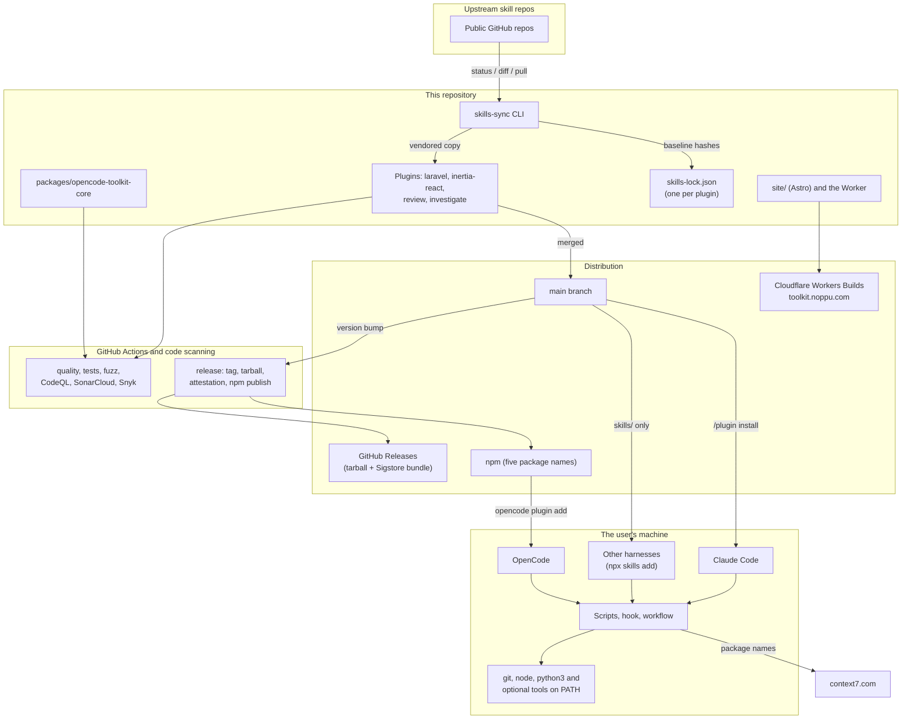

# Architecture

AI Toolkit ships four plugins for coding agents and one shared npm package. Most of what it ships is Markdown that an agent reads: skills, agents, rules and commands. The rest is a handful of scripts, one hook and one workflow that run on the user's machine when a skill calls for them. The toolkit has no server and no background process, and the only network request its released code makes is the brief script's lookup at context7.com.

This page lists the actors, what each of them does, and every interface the released assets expose. [SECURITY_ASSESSMENT.md](SECURITY_ASSESSMENT.md) covers what can go wrong, [GOVERNANCE.md](GOVERNANCE.md) says who holds which access, and the [ADRs](adr/000-index.md) give the reasons behind the decisions.

## How the pieces fit together



## Actors

### On the user's machine

| Actor | What it is | What it can do to the others |
| --- | --- | --- |
| User | The person running a coding agent in their own project | Installs a plugin, invokes skills and commands, approves or denies the agent's tool calls, sets environment variables such as `CONTEXT7_API_KEY` |
| Coding agent | Claude Code, OpenCode, or another harness that received the skills through `npx skills add` | Loads the plugin content, decides what to do with it, and runs commands, scripts and subagents with the user's permissions |
| `laravel` plugin | 16 skills, the `laravel-backend-specialist` agent, 4 path-scoped rules, the `install-rules` command | Tells the agent how to write Laravel code. The command has the agent copy the rules into the project's `.claude/rules/` |
| `inertia-react` plugin | 6 skills, the `frontend-developer` agent, 2 path-scoped rules, the `install-rules` command | The same for Inertia, React and TypeScript code |
| `review` plugin | 6 skills, four helper scripts and a Python helper, the task-output hook, the `pr-review-stages` workflow, and an OpenCode entry point | Tells the agent how to review a pull request, has it run the helper scripts and `gh`, and starts review subagents |
| `investigate` plugin | 3 skills, the brief script, and an OpenCode entry point | Tells the agent how to investigate code, and has it run the brief script |
| `packages/opencode-toolkit-core` | The loader the two OpenCode packages depend on | Reads a package's `SKILL.md` files, rewrites skill names and `${CLAUDE_PLUGIN_ROOT}` in them, and registers the result with OpenCode |
| Brief script | `investigate/skills/brief/scripts/brief.mjs` and `lib/` | Reads the target repository, starts the external tools below, queries context7.com, writes a cache in the temp directory, prints the brief |
| Task-output hook | `review/hooks/guard-task-output.mjs`, registered by `review/hooks/hooks.json` | Denies a Claude Code `Bash` or `Read` call that names a symlinked `.output` file |
| `pr-review-stages` workflow | `review/workflows/pr-review-stages.js`, a Claude Code dynamic workflow | Starts one brief agent and three stage agents per pull request, with prompts built from its arguments, and merges what they return |
| Review helper scripts | `count-comment-lines.sh`, `verify-comments-only.sh`, `lib.sh` and `python-comment-lines.py` in `review/skills/comment-audit/scripts/`, `pr-size.sh` in `pr-review/scripts/`, `render-comments.mjs` in `pr-comments/scripts/` | Read git history through `git`, and print counts, line lists or rendered comments. None of them writes a file |
| Tools on `PATH` | `git`, `node`, `bash`, `awk`, and when present `python3`, `gh`, `gitnexus`, `codegraph`, `ast-grep`, `phpantom_lsp`, `typescript-language-server` | Run with the user's permissions when a script or the agent starts them. Their output goes into the brief or the review |

### External services the released code or its users reach

| Actor | What it is | What it can do to the others |
| --- | --- | --- |
| context7.com | A public documentation index | Receives package names from the brief script. Its reply is printed in the brief the agent reads |
| GitHub (`main` branch) | Where Claude Code and `npx skills add` take plugin content from | Whatever is on `main` reaches those users |
| GitHub Releases and attestations | One release per `<name>@<version>` tag, with a tarball and a Sigstore bundle | Lets anyone download a plugin or the shared package and verify where it was built |
| npm | Hosts `@noppu-labs/opencode-review`, `@noppu-labs/opencode-investigate`, `@noppu-labs/opencode-toolkit-core`, `opencode-investigate` and `opencode-toolkit-core` | OpenCode installs the packages from it |

### In this repository and around it

| Actor | What it is | What it can do to the others |
| --- | --- | --- |
| Maintainer | See [GOVERNANCE.md](GOVERNANCE.md) | Merges pull requests, bumps versions, runs the sync CLI, holds the accounts |
| Contributor | Anyone who opens an issue or a pull request | Proposes changes. A pull request's code runs in CI |
| Upstream skill repos | The public repositories named in each `skills-lock.json` | Are the source of the vendored skills in `laravel` and `inertia-react` |
| skills-sync CLI | `npm run sync`, source in `scripts/skills-sync/` | Fetches upstream skills through `gh`, overwrites a vendored copy, rewrites lock hashes, and checks the lock against the disk |
| `quality` workflow | Runs on pull requests and on pushes to `main` | Lint, type checks, the lock check, a comparison of the loader with its published version on npm, plugin validation, the site build, and the Python checks in its `python` job |
| `tests` workflow | Same triggers | Unit and property tests with coverage, the Worker's tests, the comment-audit suite under Python 3.8, the site's tests. Writes coverage comments on pull requests |
| `fuzz` workflow | Same triggers, plus a weekly run | The property tests at 1,000 runs each, 10,000 on the weekly run |
| `release` workflow | Runs on a push to `main` that changes a `plugin.json` or a `packages/*/package.json`, and by hand for one existing tag | Creates tags and GitHub releases, signs attestations, publishes to npm |
| `backfill-release-assets` workflow | Run by hand | Builds and attests a tarball for a release that has none |
| `opencode-sync` workflow | Daily, and by hand | Copies the OpenCode plugin pages from other repositories and opens a pull request with them |
| `preview-checks` workflow | Runs when Cloudflare's check on a pull request completes | Tests the Cloudflare preview and posts a commit status |
| `scorecard` workflow | Weekly, on pushes to `main`, and when branch protection changes | Runs OpenSSF Scorecard and uploads the result to code scanning |
| CodeQL | GitHub's default setup, for Actions, JavaScript/TypeScript and Python | Posts a check on pull requests and alerts in code scanning |
| SonarCloud and Snyk | Third-party analysis connected to the repository | Each posts a check on pull requests |
| Dependabot | Configured in `.github/dependabot.yml` | Opens pull requests that update dependencies and pinned actions |
| Cloudflare Workers Builds | Cloudflare's Git integration | Builds the site and deploys it on every push to `main`, and deploys a preview for each pull request |
| Site Worker | `site/worker/index.ts`, serving `toolkit.noppu.com` | Serves the static site and three `/api/*` routes, and calls npm's downloads API |

## Actions

### Installing a plugin

There are three routes, and they do not install the same things.

- Claude Code. `/plugin marketplace add noppu-labs/ai-toolkit` reads `.claude-plugin/marketplace.json`, where each plugin's `source` is a directory of this repository (`./laravel` and so on). `/plugin install <plugin>@ai-toolkit` installs that directory from `main`, with its skills, agents, commands, rules, hook and workflow. An installed copy updates only when the `version` in the plugin's `plugin.json` changes ([ADR-001](adr/001-plugin-marketplace-monorepo.md)). The release tarball is not part of this route.
- `npx skills add noppu-labs/ai-toolkit/<plugin>`. This installs the plugin's `skills/` directory and nothing else, so there is no agent, command, hook or workflow, and `${CLAUDE_PLUGIN_ROOT}` in the skill text is not set. The [README](../README.md#install-vercel-skills-cli) says what to change by hand.
- OpenCode. `opencode plugin add @noppu-labs/opencode-review` or `@noppu-labs/opencode-investigate` installs the npm package, which holds the plugin's `skills/` and `opencode/` directories, and its dependency `@noppu-labs/opencode-toolkit-core`. `laravel` and `inertia-react` have no npm package.

### Loading skills in OpenCode

OpenCode imports the package's entry point, `opencode/index.ts`, whose default export comes from `makePlugin` in the shared package. At setup the loader (`packages/opencode-toolkit-core/load-skills.ts`):

1. Lists the directories under the package's `skills/` that hold a `SKILL.md`.
2. Reads `opencode/skills/<name>/SKILL.md` when it exists and `skills/<name>/SKILL.md` otherwise. `review` ships one such override, for `pr-review`.
3. Takes `name` and `description` from the frontmatter and fails if either is missing.
4. Rewrites skill references for OpenCode: `review:<skill>` becomes `<skill>`, `investigate:<skill>` becomes `investigate-<skill>`, and the slash form `/review:<skill>` becomes `@<skill>`.
5. Replaces `${CLAUDE_PLUGIN_ROOT}` with the package's directory, in shell quotes when the path holds whitespace, quotes, `$`, a backtick or a backslash.
6. Registers each skill through `ctx.skill.transform`, skipping an id that is already registered.

### Steering the agent

A skill is a `SKILL.md` with supporting files. The agent reads it when the user invokes it or when its description matches the task, and then acts on the user's project with its own tools. An agent file defines a subagent with a system prompt. A rule is a Markdown file with path globs that Claude Code applies to matching files once it is in the project's `.claude/rules/`. The `install-rules` command asks the agent to copy the plugin's rules there, to leave an existing file with different content alone, and to report what it did.

The toolkit executes none of this content. The agent decides what happens in the project, within the permissions the user gave it.

### Building a structural brief

`investigate:brief` has the agent run `brief.mjs` on a path. `investigate:deep`, `investigate:spec` and `review:pr-review` run it first too. The script:

1. Resolves the repository with `git rev-parse`, refuses a target that is inside a git directory, and lists the source files under the target with `git ls-files`. It keeps PHP and JavaScript/TypeScript files and skips symlinks, test files, `vendor/`, `node_modules/` and dot-directories.
2. Picks up to 15 symbols from those files (`--max-symbols`), in file path order, to describe in detail.
3. Asks `gitnexus list` whether the repository has a call-graph index and how far behind `HEAD` it is.
4. Unless `--no-lsp` is given, starts `phpantom_lsp --stdio` for PHP symbols and `typescript-language-server --stdio` for JavaScript/TypeScript symbols, sends them the files behind the symbols, and asks for method signatures and incoming calls. Before it starts the TypeScript server it asks `git ls-files` whether the repository, or a working tree around it, tracks files where that server and the TypeScript it runs load code from, and reads the version of that TypeScript. When the repository tracks such files, or the TypeScript is old enough to load a plugin from any path, it skips the TypeScript pass and says why, unless `INVESTIGATE_BRIEF_TRUST_REPO_TS=1` is set.
5. Runs `ast-grep` over `app`, `config`, `routes`, `database` and `src` for container and binding patterns, when the target has PHP files.
6. Reads `composer.lock` and `package-lock.json` at the repository root to find the installed version of each package the target imports.
7. Unless `--no-docs` is given, queries context7.com for up to 12 of those packages and compares each documented version with the installed one. See [Network calls](#network-calls).
8. Runs `codegraph explore` when the target has at least one symbol and codegraph has a database to read: the repository's own `.codegraph/codegraph.db`, or else the nearest directory above the repository that holds one, which is where codegraph itself looks. It asks `git ls-files` first and skips codegraph when git tracks anything in the repository's `.codegraph` other than the `.gitignore` codegraph writes there, because such an index came with the repository. It does not ask git about a database above the repository, and it names that directory in the brief.
9. For each symbol, runs `git grep` for references and same-named definitions, and `gitnexus context` when gitnexus has the repository in its registry.
10. Prints the brief as Markdown on standard output. Each line goes through one escape on the way out: a line break, another control character except tab, or a format character prints as an escape such as `\n`, and codegraph's lines are indented, so nothing the brief quotes from the repository or from a tool can add a line or start a heading. A backslash prints as itself. The skill has the agent redirect the brief to a file in the temp directory and read that.

Each tool is looked up on `PATH`. A missing or failing tool is reported in the brief's Tools section and its part is left out. The run stops only when `git` is missing or older than 2.13, or when the target does not exist, is outside a repository, is inside a git directory or holds no source files.

### Reviewing a pull request

`review:pr-review` is prose the agent follows. For each pull request it has the agent:

1. Read the pull request with `gh pr view`, and fetch the base branch and the head into `refs/pr-review/<n>` with `git fetch`.
2. Size the diff with `pr-size.sh`.
3. Build a structural brief. With the `investigate` plugin installed that means the brief script, run in the current checkout when it is a clean checkout of the head and otherwise in a scratch worktree the agent creates and removes. Without it, the brief comes from a few `git diff` and `git grep` commands.
4. Run the first correctness pass with the harness's `code-review` skill, or with `review:correctness-review` where there is none.
5. Start three stage subagents (correctness, type safety, comments) and merge their reports into one.

On Claude Code with dynamic workflows enabled, steps 3 and 5 run through the `pr-review-stages` workflow, which validates its arguments, builds each prompt from a fixed template, checks every agent's return against a JSON schema and consolidates in plain JavaScript. Elsewhere the agent does the same steps by hand. The stage prompts tell the subagents to run the project's own tests and linters where that confirms a finding.

`review:comment-audit` counts the comment lines a branch adds with `count-comment-lines.sh` and writes a report. With `--apply` it edits comments, makes one commit, and checks with `verify-comments-only.sh` that the commit changed nothing but comments. It does not push. `review:pr-comments` turns a report into comments with `render-comments.mjs` and posts nothing.

### Guarding task output

On Claude Code, the hook runs before a `Bash` call whose command contains `.output` and before a `Read` of a path ending in `.output`. It reads the call from standard input, resolves each `.output` path it finds against the session's working directory, and checks with `lstat` whether one of them is a symlink. If so it prints a deny decision with a reason for the agent. In every other case, including input it cannot parse, it prints nothing and the call goes ahead. [The review README](../review/README.md#the-task-output-hook) explains why the hook exists.

### Vendoring upstream skills

A maintainer runs `npm run sync -- status`, `diff` or `pull` ([MAINTENANCE.md](MAINTENANCE.md#syncing-vendored-skills-with-upstream)). The CLI calls `gh api` for the upstream repository's commit, directory listings and blobs, hashes the files, and on `pull` overwrites the vendored directory and updates the lock. The result reaches `main` through a pull request like any other change. `npm run sync -- verify` makes no network call: it checks that every skill directory matches the hash in its lock entry, and CI runs it on every pull request and before every release ([ADR-002](adr/002-vendored-skills-with-lockfile.md)).

### Checking a change

Every pull request runs `quality`, `tests` and `fuzz`, CodeQL, SonarCloud, Snyk, and Cloudflare's preview build followed by `preview-checks`. Only `quality` and `tests` are required to merge. [GOVERNANCE.md](GOVERNANCE.md#how-a-change-reaches-main) has the merge rules.

### Releasing

A push to `main` that changes a `plugin.json` or a `packages/*/package.json` starts `.github/workflows/release.yml` ([ADR-006](adr/006-release-automation-and-provenance.md), [MAINTENANCE.md](MAINTENANCE.md#versioning-and-releasing-plugin-changes)).

The `release` job handles every plugin and shared package whose `<name>@<version>` tag does not exist yet:

1. It packs the directory into `<name>-<version>.tgz` with `tar`.
2. It installs the tooling with `npm ci --ignore-scripts`, then runs the lock check and `claude plugin validate`.
3. It signs a build provenance attestation for the tarballs with `actions/attest-build-provenance` and extracts each tarball's Sigstore bundle.
4. It writes release notes with `scripts/release-notes.sh`, pushes the annotated tag at the pushed commit, and creates the GitHub release with the tarball and the bundle attached.

The npm jobs then run for each released directory that has a `package.json`: `review`, `investigate` and `packages/opencode-toolkit-core`.

1. `npm-build` checks out the tag, checks that the tag, `package.json` and `plugin.json` versions agree, runs the OpenCode tests, and packs the package with `npm pack --ignore-scripts`. If that version is already on npm, the packed tarball must be byte-identical to it. For a plugin it also packs the loader, compares it with the published loader of the same version, and checks that the plugin's loader range resolves. A smoke test then installs the tarball, and the tarball goes to the publish jobs as a workflow artifact with a SHA-256 checksum.
2. `npm-publish-shared` publishes the shared package first, then `npm-publish` publishes the plugins. Each checks that the tag still points at the commit it checked out, verifies the checksum, and runs `npm publish --provenance` through npm trusted publishing, so the job's OIDC token is the credential and no npm token is stored.
3. For a name listed in `UNSCOPED_NAMES`, the job unpacks the same tarball, changes the package name to the unscoped one, and publishes that as well.

Running the workflow by hand with a tag repeats the npm jobs for that tag without creating a tag or a release.

### Publishing the site

Cloudflare Workers Builds builds `site/` with Astro and deploys the result with the Worker on every push to `main`, and deploys a preview for each pull request ([ADR-010](adr/010-project-website-on-cloudflare-workers.md)). No workflow in this repository deploys the site. The pages under `/opencode` are copies of files from other plugin repositories, refreshed by the `opencode-sync` pull request ([opencode-pages.md](opencode-pages.md)). The site's pages load Google Analytics depending on the visitor's country and consent choice ([ADR-014](adr/014-site-analytics-behind-consent.md), [ADR-015](adr/015-opt-out-analytics-outside-europe.md)).

### Keeping dependencies current

Dependabot opens weekly pull requests for the pinned actions, the two npm manifests and the Python tooling. [CONTRIBUTING.md](../CONTRIBUTING.md#dependencies) describes the manifests and lockfiles.

## External interfaces

### Released assets

| Asset | Where | What it holds |
| --- | --- | --- |
| `laravel-<version>.tgz`, `inertia-react-<version>.tgz`, `review-<version>.tgz`, `investigate-<version>.tgz` | GitHub Releases, under the tag `<plugin>@<version>` | The whole plugin directory |
| `opencode-toolkit-core-<version>.tgz` | GitHub Releases, under `opencode-toolkit-core@<version>` | `packages/opencode-toolkit-core` |
| `<name>-<version>.tgz.intoto.jsonl` | Beside each tarball | The tarball's Sigstore bundle, for `gh attestation verify` |
| `@noppu-labs/opencode-review` | npm | `review/skills/`, `review/opencode/`, the README and the license |
| `@noppu-labs/opencode-investigate` and `opencode-investigate` | npm | `investigate/skills/`, `investigate/opencode/`, the README and the license |
| `@noppu-labs/opencode-toolkit-core` and `opencode-toolkit-core` | npm | `index.ts`, `naming.ts`, `load-skills.ts`, the README and the license |

The npm packages do not contain `review/hooks/` or `review/workflows/`, which are Claude Code features.

### Skills

| Plugin | Skills |
| --- | --- |
| `laravel` | `laravel-activity-logging`, `laravel-controllers`, `laravel-database-optimization`, `laravel-dtos`, `laravel-enums`, `laravel-models`, `laravel-owasp-security`, `laravel-policies`, `laravel-quality`, `laravel-query-builders`, `laravel-routing`, `laravel-services`, `laravel-testing`, `laravel-validation`, `laravel-value-objects`, `php-best-practices` |
| `inertia-react` | `laravel-inertia-react`, `react-vite-best-practices`, `shadcn`, `state-management`, `tailwind-best-practices`, `typescript-react-patterns` |
| `review` | `comment-audit`, `correctness-review`, `pr-comments`, `pr-review`, `type-safety-review`, `writing-comments` |
| `investigate` | `brief`, `deep`, `spec` |

How a skill is invoked depends on the harness:

- Claude Code: `/<plugin>:<skill>`, for example `/review:pr-review 123`, or the agent picks the skill from its description.
- OpenCode: `@<id>` or the `/skills` picker. The ids of `review` are the bare skill names (`@pr-review`). The ids of `investigate` are `investigate-brief`, `investigate-deep` and `investigate-spec`.
- After `npx skills add`: the harness that received the `skills/` directories decides.

Four skills take arguments:

| Skill | Input |
| --- | --- |
| `review:pr-review` | `<pr> [<pr> ...]`: one pull request number, or several forming a stack in merge order |
| `review:comment-audit` | `[--apply] [key=value ...]` with the keys `base`, `head`, `dirs`, `readme`, `ticket`, `out` and `sibling`. Without `--apply` the only file written is the report |
| `review:pr-comments` | `[key=value ...]` with the keys `report`, `pr`, `format` (`markdown` or `json`) and `out` |
| `investigate:brief` | A target path, and the brief script's flags |

`investigate:deep` takes a path or a free-text subject. `investigate:spec` takes a file path, a ticket or document id, or pasted text.

### Commands, agents and rules

| Kind | Name | Where it comes from |
| --- | --- | --- |
| Command | `/laravel:install-rules` | `laravel/commands/install-rules.md` |
| Command | `/inertia-react:install-rules` | `inertia-react/commands/install-rules.md` |
| Agent | `laravel-backend-specialist` | `laravel/agents/laravel-backend-specialist.md` |
| Agent | `frontend-developer` | `inertia-react/agents/frontend-developer.md` |

Both agent files set `model: sonnet` and `memory: project`.

| Rule file | Applies to |
| --- | --- |
| `laravel/rules/code-quality-php.md` | `{app,bootstrap,config,database,routes,tests}/**/*.php` |
| `laravel/rules/service-providers.md` | `app/Providers/**/*.php` |
| `laravel/rules/testing-pest.md` | `tests/**/*` |
| `laravel/rules/validation-dtos.md` | `app/**/Dtos/*.php`, `app/**/Rules/*.php`, `app/**/Concerns/*.php`, `app/Support/**/*.php` |
| `inertia-react/rules/code-quality-ts.md` | `resources/js/**/*.{ts,tsx}`, `.storybook/**/*.{ts,tsx}`, `*.config.ts` |
| `inertia-react/rules/testing-vitest.md` | `resources/js/**/*.test.{ts,tsx}` |

The rules reach a project only through the `install-rules` command, which writes them to `.claude/rules/<name>` and never overwrites a file whose content differs.

### The hook registration

`review/hooks/hooks.json` registers two `PreToolUse` entries, both running `node "${CLAUDE_PLUGIN_ROOT}/hooks/guard-task-output.mjs"` with a 10-second timeout:

| Matcher | `if` rule |
| --- | --- |
| `Bash` | `Bash(*.output*)` |
| `Read` | `Read(//**/*.output)` |

Input is Claude Code's hook JSON on standard input; the hook reads `tool_name`, `tool_input.command` or `tool_input.file_path`, and `cwd`. Output is either nothing or one JSON object with `hookSpecificOutput.permissionDecision` set to `deny` and a `permissionDecisionReason`. The hook reads no environment variable and writes no file.

### The `pr-review-stages` workflow

The workflow is invoked as `review:pr-review-stages` through Claude Code's Workflow tool. Its `args` is a non-empty JSON array with one object per pull request, in merge order:

| Field | Value |
| --- | --- |
| `number` | A positive integer, unique in the list |
| `title`, `base`, `head`, `url` | Non-empty strings |
| `headSha` | The full 40-character SHA of the commit under review |
| `instructions` | Optional. An object with any of `brief`, `correctness`, `typeSafety`, `comments` and `all`, each a non-empty string appended to that agent's prompt |

Any other shape, an unknown `instructions` key or a repeated number is rejected before an agent starts. The workflow returns `{ report, counts }`: the consolidated Markdown report, and for each pull request the number of findings per stage. [The review README](../review/README.md#the-pr-review-stages-workflow) covers versions and permissions.

### The brief script

```text
node brief.mjs <target-path> [--max-symbols N] [--no-docs] [--no-lsp] [--help]
```

| Flag | Effect |
| --- | --- |
| `--max-symbols N` | The number of symbols given a detailed section. A positive integer, 15 by default |
| `--no-docs` | Skips the context7 lookup |
| `--no-lsp` | Skips both language servers |
| `-h`, `--help` | Prints the usage line and exits 0 |

The script exits 0 after printing a brief and 1 on a usage error or a failure, with one line on standard error. It needs Node 20 or later and `git`.

| Environment variable | Effect |
| --- | --- |
| `CONTEXT7_API_KEY` | Sent to context7 as `Authorization: Bearer <key>`. Without it the lookups are anonymous |
| `INVESTIGATE_BRIEF_C7_URL` | Replaces the context7 search URL. The key, when set, is sent to that URL |
| `INVESTIGATE_BRIEF_CACHE_DIR` | Replaces the cache directory |
| `INVESTIGATE_BRIEF_TRUST_REPO_TS` | `1` runs the TypeScript pass on a repository that tracks files where the server loads code from. Any other value leaves the check on |
| `PATH` | Where every external tool is looked up |

The script passes its whole environment to the tools it starts.

It reads the source files under the target, and `composer.json`, `composer.lock` and `package-lock.json` at the repository root. It sends the content of the files behind the detailed symbols to the language servers, which are local processes. It writes one kind of file: a JSON cache entry per package under `investigate-brief/context7/` in the operating system's temp directory, kept for six hours.

It starts these programs: `git` (`rev-parse`, `ls-files`, `grep`, `rev-list`), `gitnexus` (`list`, `context`), `codegraph` (`explore`), `ast-grep`, `phpantom_lsp` and `typescript-language-server`. Before using an optional tool it runs it with `--version`. A command has 15 seconds by default, and the language servers have up to 90 seconds to start.

### The review scripts

| Script | Command line | Output and exit status |
| --- | --- | --- |
| `count-comment-lines.sh` | `BASE HEAD [DIR...]` | The number of comment lines added between the two commits. 2 on a usage error or a ref that is not a commit |
| `verify-comments-only.sh` | `FROM TO [DIR...]` | Every changed line that is not a comment or blank, and exit 1 when there is one. Otherwise `only comment lines changed` |
| `python-comment-lines.py` | `REF`, with NUL-separated paths on standard input | `path<TAB>line` for each comment line, then `== done`. Exit 1 when a file could not be read or parsed |
| `pr-size.sh` | `BASE HEAD` | One line: `lines=<n> code-review=high\|xhigh\|max correctness-review=1\|3\|4` |
| `render-comments.mjs` | `[--format json\|markdown]`, with the findings as JSON on standard input | The rendered comments. 1 on invalid input, 2 on a usage error |

The two comment scripts source `lib.sh` and run `git diff`, `awk`, and the Python helper when an interpreter is found. `REVIEW_PYTHON` names the interpreter and defaults to `python3`. The helper needs Python 3.8 or later, uses only the standard library, and reads file content with `git cat-file --batch`. None of these scripts makes a network call or writes a file.

### The OpenCode packages

`@noppu-labs/opencode-review` and `@noppu-labs/opencode-investigate` have the same export map:

| Export | Resolves to | What it is |
| --- | --- | --- |
| `.` and `./server` | `opencode/index.ts` | The default export, an OpenCode plugin with the id `noppu-labs.review` or `noppu-labs.investigate` |
| `./package.json` | `package.json` | The manifest |

They take no options. Each has one dependency, `@noppu-labs/opencode-toolkit-core`. `opencode-investigate` is the same content as `@noppu-labs/opencode-investigate` under another name.

`@noppu-labs/opencode-toolkit-core`, and its unscoped copy `opencode-toolkit-core`, export:

| Export | Resolves to | What it is |
| --- | --- | --- |
| `.` | `index.ts` | `makePlugin(options, load?)` and the type `PluginOptions`, which is `{ id, namespace, packageRoot }` |
| `./package.json` | `package.json` | The manifest |

`namespace` must be `review` or `investigate`; any other value throws. The package has no dependencies, and it ships TypeScript source that OpenCode loads as it is.

### Network calls

The brief script makes the only network request in the released code. For each of the first 12 imported packages that are not development dependencies, in name order, it sends:

```text
GET https://context7.com/api/v1/search?query=<name>
```

`<name>` is the package name, or the scope alone for a scoped npm package. Nothing else about the repository is sent: no code, no path and no version. The request has an 8-second timeout. From the reply the script keeps the first six results and, of each, the id, title, branch, version list, update date and benchmark score. An HTTP error, a timeout or an unexpected reply marks that package's lookup as failed and the brief is still built.

The script tells `typescript-language-server` to turn off TypeScript's automatic type acquisition, which would otherwise download type packages named by the repository.

The skills also have the agent call `gh` for pull request data and `git fetch` for refs, and the `investigate` skills point the agent at whatever documentation tool its harness has. Those requests are made by the user's own tools with the user's own credentials.

### Files written on the user's machine

| File | Written by |
| --- | --- |
| `investigate-brief/context7/<package>.json` under the temp directory | The brief script |
| The brief, redirected to `${TMPDIR:-/tmp}/brief-<module>.md` | The agent, as `investigate:brief` instructs |
| `.claude/rules/<name>.md` in the project | The agent, on `/laravel:install-rules` or `/inertia-react:install-rules` |
| The comment-audit report, and with `--apply` the edited comments and one commit | The agent, as `review:comment-audit` instructs |
| `refs/pr-review/<n>` in the clone, and a scratch worktree that is removed afterwards | The agent, as `review:pr-review` instructs |

### The site's HTTP routes

The site is not a released asset, but its Worker is public. Every path is a static file except:

| Route | Input | Output |
| --- | --- | --- |
| `/api/badges/npm-downloads` | None | A shields.io endpoint JSON with the total downloads of the five npm names, cached for six hours |
| `/api/consent-mode` | The visitor's country, from Cloudflare | `{ "mode": "opt-in" }` or `{ "mode": "opt-out" }` |
| `POST /api/consent` | `{ "choice": "granted" \| "denied" \| "acknowledged" }`, with an `Origin` header equal to the site's origin | `204` and a `noppu_analytics_consent` cookie. `403` for another origin, `400` for another choice, `405` for another method |
